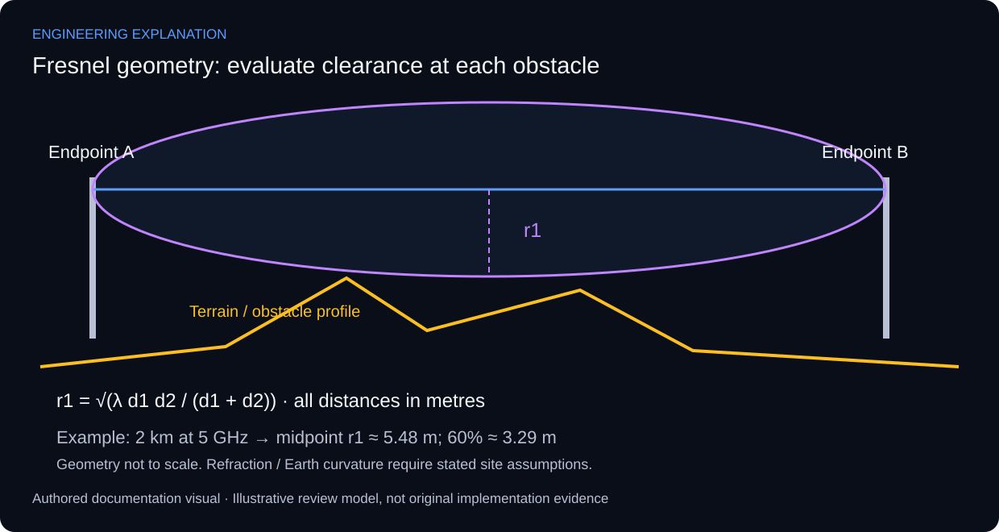

# Line-of-Sight & Fresnel Zone Wireless Planning Tool

## Clearance is a path profile, not only a sight line

This independent planning application addresses line-of-sight and Fresnel-zone clearance. Its purpose complements the RF calculator: the link budget evaluates power, while the path profile evaluates geometry and obstruction. The available preview is an interface/document view rather than an installed radio-link photograph.

The first Fresnel radius varies along the path. With wavelength λ and distances d1 and d2 from the inspected point to the endpoints, r1 = sqrt(λ d1 d2 / (d1 + d2)), using metres consistently. The maximum radius occurs at the midpoint for a level path, but the critical clearance point can lie elsewhere where terrain or an obstacle rises.

For an illustrative 2 km path at 5 GHz, λ is approximately 0.060 m. At the midpoint, r1 is approximately 5.48 m. A 60% radius corresponds to about 3.29 m. That percentage is an illustrative planning screen, not a universal acceptance condition: ITU-R P.530 considers climate, effective Earth radius, diffraction and availability requirements when specifying clearance.

A complete review therefore combines endpoint elevations and antenna heights with a terrain profile, obstacle heights and the selected refraction assumptions. Straight-line visibility alone can conceal Fresnel obstruction. Any recommended mast height must identify its survey inputs and assumptions; the available material does not support a site-specific height recommendation.

*New explanatory responsibilities and review criteria; not an as-built drawing or new test result.*

## Review scenarios and expected evidence

These are review criteria, not additional completed tests.

| Review area | Method | Evidence to inspect |
|---|---|---|
| Midpoint check | Evaluate equal endpoint distances | Maximum r1 for the same unobstructed path |
| Frequency scaling | Increase frequency by a factor of four | Radius becomes half |
| Off-centre obstacle | Evaluate its actual d1 and d2 | Local radius used, not midpoint radius |
| Site acceptance | Review terrain and effective-radius assumptions | Documented profile and applicable clearance criterion |

## Primary technical references

- [ITU-R P.530 — terrestrial line-of-sight link design](https://www.itu.int/rec/R-REC-P.530/en)

References support the explanation, not undocumented implementation claims.

The numerical example and diagram explain calculation geometry. They are not a site survey, recovered application output or measured acceptance record.

[Published case study](https://mahyoub88.github.io/projects/proj-fresnel-planning/).
