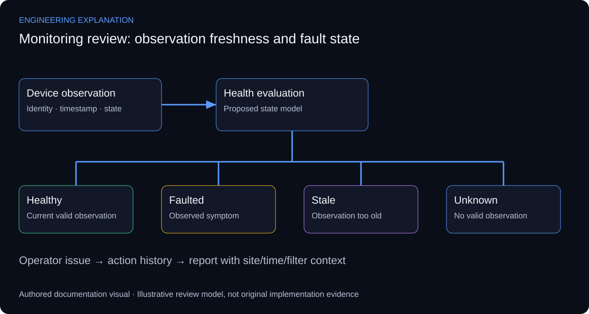

# Monitoring & Diagnostics Console — VB.NET

## Making health state traceable to an observation

The original interface documents a VB.NET WinForms application for multi-site monitoring, diagnostics, issue tracking and reporting. The public release contains the interface preview and analysis, not recovered source code or a database export. Therefore the design discussion separates visible responsibilities from proposed internals.

A health display needs device identity, observation time and observation meaning. The explanatory model distinguishes healthy, faulted, stale and unknown states. A missing observation should not silently become a healthy device, and a reachable endpoint does not establish application-level correctness. These state rules are proposed review criteria rather than a claim about the unrecovered implementation.

Data acquisition, health evaluation, issue management and presentation are different responsibilities. Windows Forms binding explains how controls can present records, while input validation supports operator-entered fields. Neither reference establishes the original application’s polling mechanism, storage engine or threading model. RFC 5424 is used only for event-record concepts; syslog support is not asserted.

An operator workflow should make the affected site/device, symptom and latest evidence visible before an issue is acknowledged or closed. Reports need to retain time range and filters so the same record can be understood later. Demonstrating this professionally would use a synthetic dataset clearly labelled as a UI demonstration, rather than invented production uptime.

*New explanatory responsibilities and review criteria; not an as-built drawing or new test result.*

## Review scenarios and expected evidence

These are review criteria, not additional completed tests.

| Review area | Method | Evidence to inspect |
|---|---|---|
| Missing observation | Stop an illustrative update stream | Stale/unknown distinguished from healthy |
| Device fault | Supply a fault state in reference data | Affected identity and symptom preserved |
| Operator action | Acknowledge then review an issue | Action does not erase source observation |
| Report filter | Change site and time range | Report states the applied context |

## Primary technical references

- [Microsoft — Windows Forms input validation](https://learn.microsoft.com/en-us/dotnet/desktop/winforms/input-keyboard/validation)
- [Microsoft — Windows Forms data binding](https://learn.microsoft.com/en-us/dotnet/desktop/winforms/data/overview)
- [Syslog message model — RFC 5424](https://www.rfc-editor.org/rfc/rfc5424)

References support the explanation, not undocumented implementation claims.

This is an interface-informed proposed design. No extra application screenshot, running demo or implemented backend feature is represented as recovered source evidence.

[Published case study](https://mahyoub88.github.io/projects/proj-monitoring-console/).
