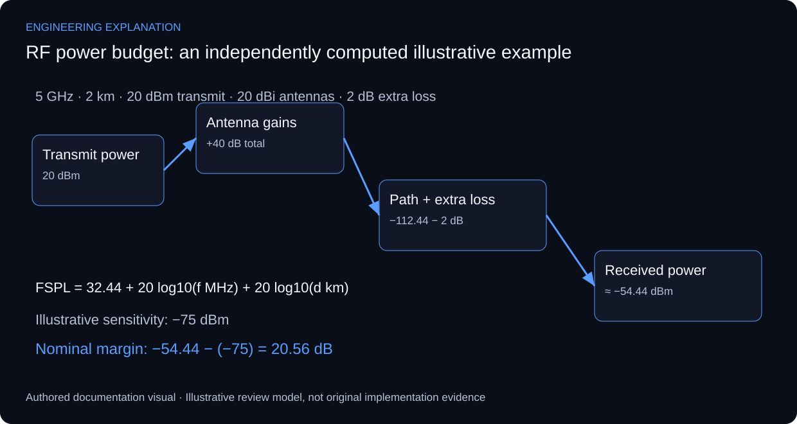

# RF Link Budget & Propagation Analysis Engine

## Keeping power, loss and margin in consistent units

The VB.NET application addresses path loss, receiver sensitivity, noise and RF link-budget calculations. The original interface supports its calculator purpose. A professional walkthrough must expose the input units and assumptions as well as the output, so a reviewer can recompute a result without access to the original source code.

Received power combines transmit power in dBm, antenna gains in dBi and path/cable losses in dB. Free-space path loss is only one part of the propagation model. Obstacles, diffraction, atmospheric effects and interference can change a field link; a positive calculated margin is therefore not a recorded availability or throughput result.

Illustrative calculation: at 5 GHz over 2 km, FSPL = 32.44 + 20 log10(5000 MHz) + 20 log10(2 km), approximately 112.44 dB. For 20 dBm transmit power, two 20 dBi antennas and 2 dB of total additional loss, received power is approximately −54.44 dBm. With an illustrative −75 dBm sensitivity, the nominal margin is 20.56 dB. These are independently computed example inputs, not recovered deployment parameters.

The receiver threshold depends on bandwidth, modulation and required quality. Thermal-noise reasoning must state bandwidth and receiver noise figure before adding an SNR requirement. ITU-R P.530 supports terrestrial link-design context, but does not replace a selected radio data sheet or site survey. The calculator review checks arithmetic, dimensions and rejected inputs separately.

*New explanatory responsibilities and review criteria; not an as-built drawing or new test result.*

## Review scenarios and expected evidence

These are review criteria, not additional completed tests.

| Review area | Method | Evidence to inspect |
|---|---|---|
| Unit conversion | Enter equivalent GHz/MHz representations | Same FSPL after explicit conversion |
| Distance scaling | Double distance in free space | FSPL increases by about 6.02 dB |
| Additional loss | Add 3 dB cable loss | Received power and margin drop by 3 dB |
| Invalid input | Zero or negative frequency/distance | Reject before logarithmic calculation |

## Primary technical references

- [ITU-R P.530 — terrestrial line-of-sight link design](https://www.itu.int/rec/R-REC-P.530/en)

References support the explanation, not undocumented implementation claims.

The worked values are illustrative. They are not a measured RF link, deployment-specific result or recovered program output.

[Published case study](https://mahyoub88.github.io/projects/proj-rf-link-budget/).
