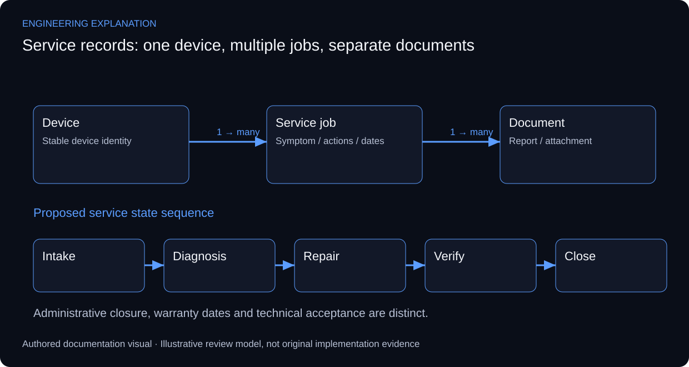

# Service Operations & Technical Documentation Management System

## Connecting a device to its complete service history

The source interface shows device records, repair information and warranty/calibration fields. Its purpose is service operations and technical documentation, which differs from monitoring live device health. The public evidence is an application preview; source code, storage schema and exported service reports have not been recovered.

An explanatory data model separates a device from individual service jobs and their documents. A device may have several interventions, and a repair may have several observations and attachments. This prevents a proposed design from overwriting history whenever a new visit is recorded. The relationships explain the application’s purpose; they do not disclose its original database tables.

A service workflow can progress through intake, diagnosis, repair, verification and closure, with responsibility and supporting records at each stage. A closed ticket and a calibrated device are different statements. Calibration needs its own procedure and result; a warranty date is administrative information and should not become evidence of technical acceptance.

Microsoft’s validation and binding guidance supports form-field handling and display of records. Appropriate review scenarios include invalid dates, missing device identity, duplicate references, attachment handling and retrieval of past work. The example state sequence is proposed for documentation; specific controls, permissions and export formats remain unverified.

*New explanatory responsibilities and review criteria; not an as-built drawing or new test result.*

## Review scenarios and expected evidence

These are review criteria, not additional completed tests.

| Review area | Method | Evidence to inspect |
|---|---|---|
| New service visit | Associate a second job with one device | Prior job remains retrievable |
| Invalid date | End date precedes intake date | Validation explains the conflicting field |
| Attachment reference | Review a missing or replaced document | Record shows its document status |
| Closure | Attempt closure without verification context | Review rule distinguishes repair from acceptance |

## Primary technical references

- [Microsoft — Windows Forms input validation](https://learn.microsoft.com/en-us/dotnet/desktop/winforms/input-keyboard/validation)
- [Microsoft — Windows Forms data binding](https://learn.microsoft.com/en-us/dotnet/desktop/winforms/data/overview)

References support the explanation, not undocumented implementation claims.

The workflow and relationships are a proposed reconstruction from the interface. They are not a recovered schema or a claim that every validation rule is implemented.

[Published case study](https://mahyoub88.github.io/projects/proj-service-operations/).
